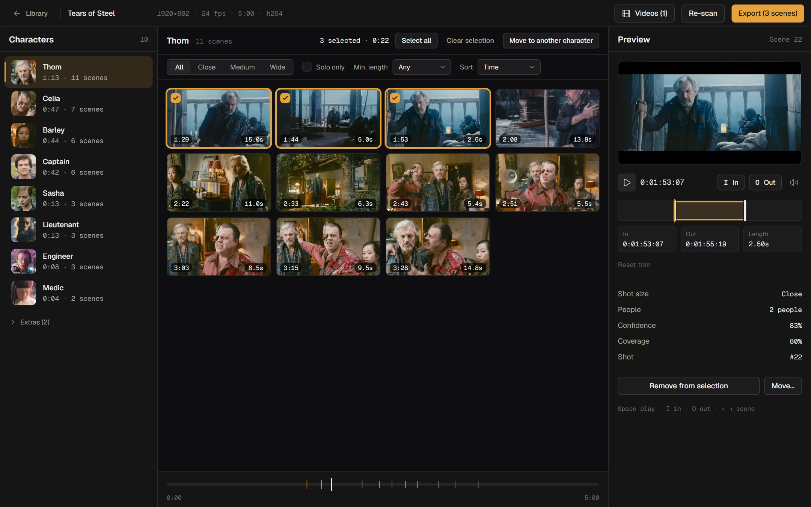
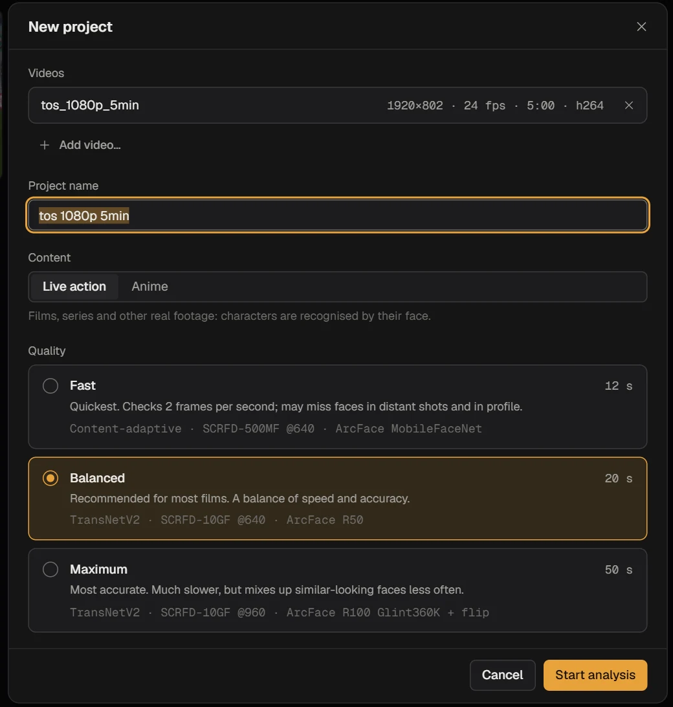
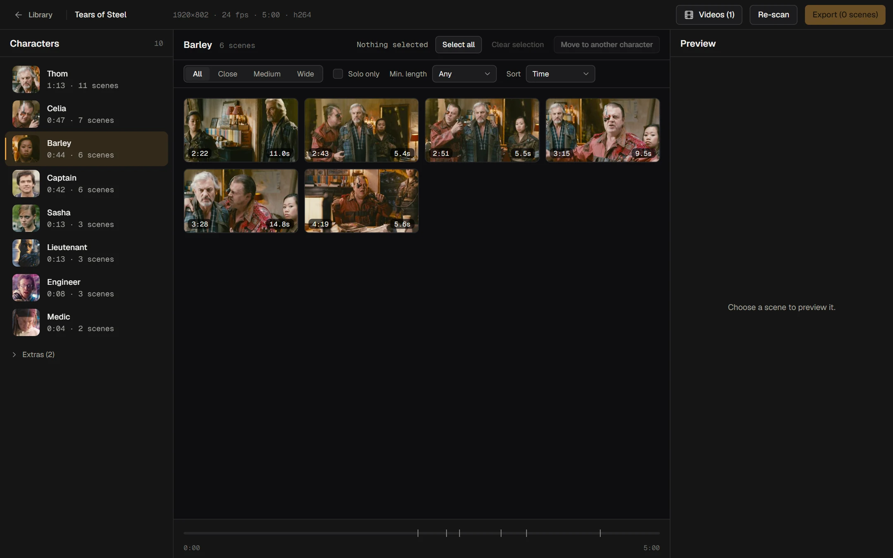
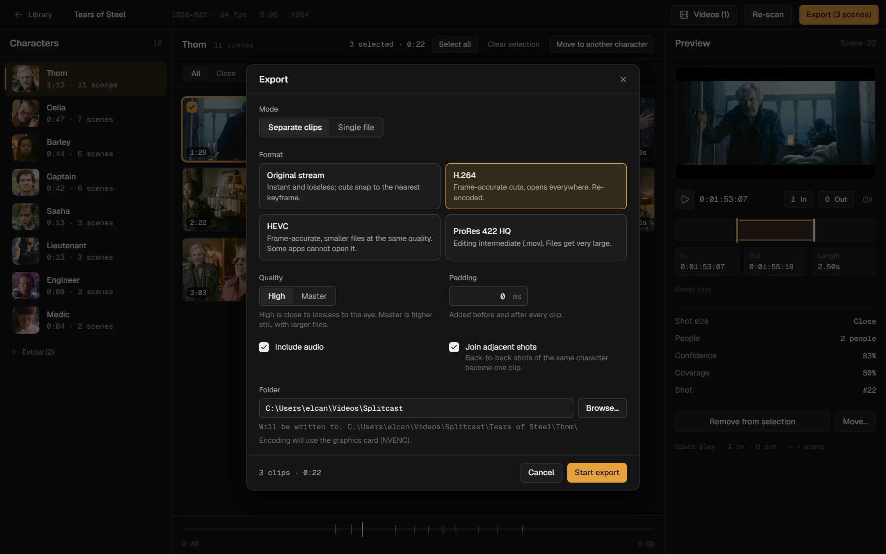
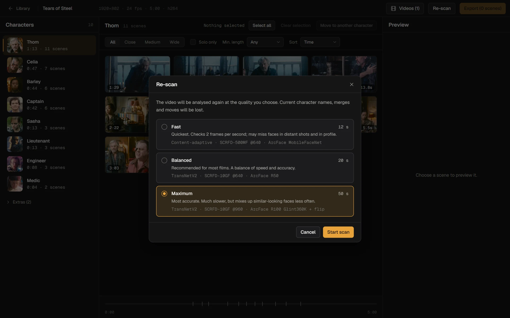
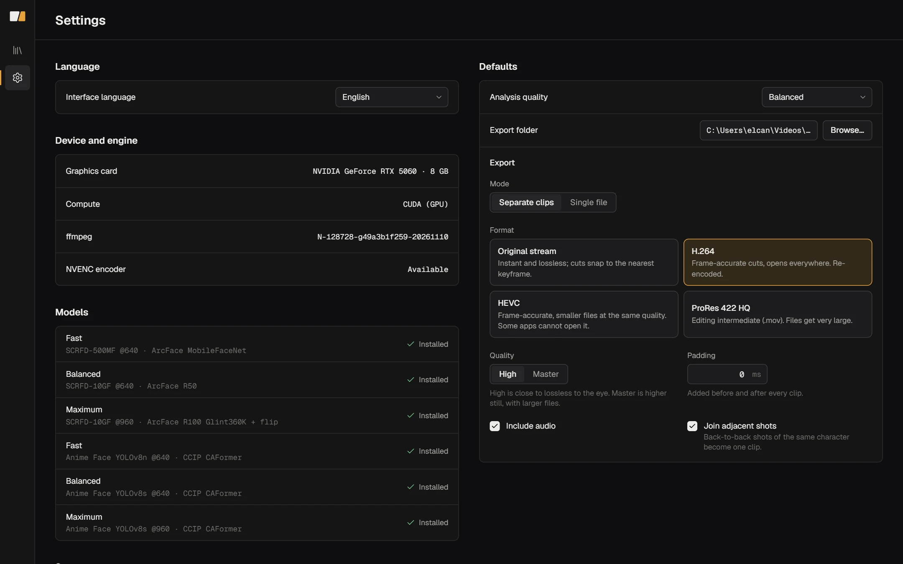
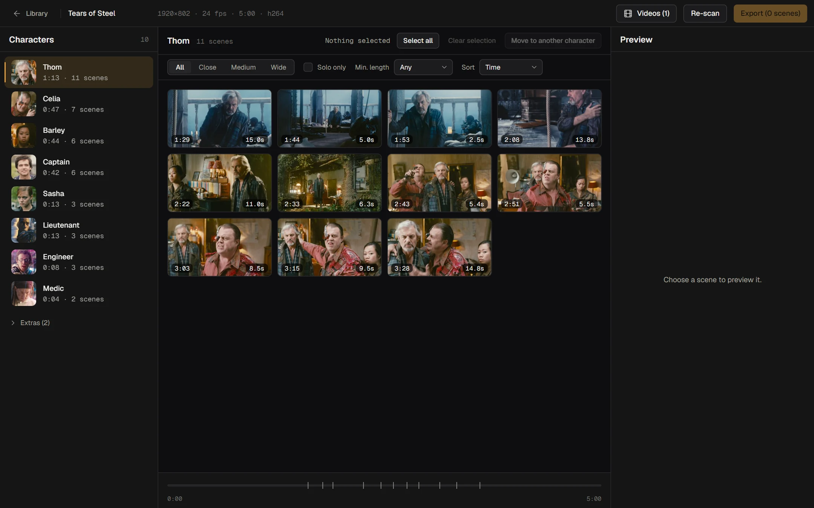

<p align="center">
  
</p>

<h1 align="center">Splitcast</h1>

<p align="center">
  <b>One film in. One cast per character out.</b><br />
  A free, open-source Windows app that finds every character in a film or a whole season<br />
  and exports their scenes as clean clips. The AI runs on your own GPU. Nothing is uploaded.
</p>

<p align="center">
  
  
  
  
</p>

<p align="center">
  
</p>
<p align="center"><sub>Footage: <a href="https://mango.blender.org">Tears of Steel</a> (CC-BY 3.0, Blender Foundation).</sub></p>

---

## What it does

Editors who make character edits, scenepacks or fan compilations spend hours scrubbing a film for one person's shots. Splitcast does the scrubbing:

1. **Drop in** a film, an episode, or a whole season.
2. It **detects shots, finds faces, and groups them into characters**, ranked by screen time.
3. You **review, trim to the frame, and export** each character's scenes as separate clips or one file.

Think of it as the tool you wish came with every scenepack you've ever downloaded.

## Features

- **Per-character scenepacks.** Every shot a character appears in, sorted and ready to pick from.
- **Seasons.** Add every episode to one project. A character keeps the same identity across episodes, so you get one scenepack per character for the whole season.
- **Anime mode.** A separate model for drawn characters: it looks at hair, eyes and outfit instead of facial geometry.
- **Three quality levels.** Fast, Balanced, Maximum. Slower means fewer mix-ups between similar faces. You see an estimate before you start.
- **Frame-accurate review.** Play, set In/Out with `I` and `O`, step between scenes with the arrow keys. A strip under the grid shows where the character appears in the film.
- **Filters.** Shot size (close, medium, wide), solo shots only, minimum length.
- **Best scenes.** One click picks the top 25 / 50 / 75 % of a character's scenes by how usable they are: large in frame, recognised with confidence, alone, long enough. Handy when a character has 40 minutes of scenes and you only want the good 15.
- **Fix mistakes.** Move scenes to another character, merge two characters, hide extras.
- **Export your way.** Copy the original stream (instant, lossless), or re-encode with H.264, HEVC or ProRes 422 HQ. NVENC is used when your GPU supports it. The dialog shows an estimated time for the format and quality you pick.
- **Private.** No account, no cloud, no telemetry. Models are downloaded once; analysis and export run offline.
- **16 interface languages**, including right-to-left layout for Arabic.

## A quick tour

<table>
  <tr>
    <td width="33%" valign="top">
      <br />
      <b>1. Drop it in.</b> Pick <i>Live action</i> or <i>Anime</i> and a quality level.
    </td>
    <td width="33%" valign="top">
      <br />
      <b>2. Find the cast.</b> Click a character to see every scene they are in.
    </td>
    <td width="33%" valign="top">
      <br />
      <b>3. Export.</b> Separate clips or one file, in the format you need.
    </td>
  </tr>
</table>

<details>
<summary>More screenshots</summary>

| | |
|---|---|
|  |  |
|  |  |

</details>

## Quality levels

| Level | Shots | Faces | Recognition | Speed* |
|---|---|---|---|---|
| **Fast** | content-adaptive | SCRFD-500MF @640 | ArcFace MobileFaceNet | ~5× real time |
| **Balanced** | TransNetV2 | SCRFD-10GF @640 | ArcFace R50 | ~4× |
| **Maximum** | TransNetV2 | SCRFD-10GF @960 | ArcFace R100 (Glint360K) + flip | ~3× |

<sub>* Live action, 1080p H.264 on an RTX 5060 (measured 2–5× real time, so a 50-minute episode takes roughly 10–20 minutes). Decoding runs on the CPU, so a busy computer is slower. Your numbers will vary.</sub>

Anime mode uses the [deepghs](https://huggingface.co/deepghs) anime face detector (YOLOv8) and CCIP character embeddings instead of the face models above.

## Install

Pick the installer for your graphics card from the [latest release](https://github.com/elcann7/splitcast/releases/latest):

| Your GPU | Download | Size | Status |
|---|---|---|---|
| **NVIDIA** (GeForce, RTX, Quadro) | `Splitcast-Setup-NVIDIA-x.y.z.exe` | ~1.5 GB | Tested on an RTX 5060 |
| **AMD**, **Intel** (Arc or integrated) or any other DirectX 12 GPU | `Splitcast-Setup-AMD-Intel-x.y.z.exe` | ~0.6 GB | **Experimental**, see below |

Not sure? Press Win+R, type `dxdiag`, open the *Display* tab and read the name of your card.

1. Run the installer. No admin rights, no Python, no internet needed while installing: the app, the AI runtime, ffmpeg and the Balanced models are all inside.
2. Open **Splitcast** from the Start menu.

Windows may show a SmartScreen notice because the installers are not code-signed yet. Choose *More info → Run anyway*.

Fast, Maximum and the anime models are not in the installer; Splitcast downloads them once, the first time you pick that quality.

User data (projects, models, settings, log) lives in `%LOCALAPPDATA%\Splitcast`. Uninstalling asks whether to delete it.

### About the AMD / Intel build

It uses **DirectML**, which runs the same models on any DirectX 12 GPU. What has been verified and what has not:

- **Verified:** the whole analysis pipeline runs through DirectML and finds the same characters as the NVIDIA build (tested on an NVIDIA card through DirectML; about 4× real time on Balanced).
- **Not verified:** no AMD or Intel card has been available for testing. Driver differences may show up.
- **It protects itself:** if a model fails on the GPU, that model continues on the CPU (slower, never broken). The reason is shown under *Settings → Compute*.
- **Video export:** AMD (AMF) and Intel (Quick Sync) hardware encoders are used only if a real test encode succeeds on your machine; otherwise the CPU encoder is used.
- To force the CPU (for troubleshooting), set the environment variable `SCENEPACK_FORCE_CPU=1`.

If something does not work on your card, please open an issue and include the text from *Settings → Compute* and `%LOCALAPPDATA%\Splitcast\app.log`.

### Requirements

- Windows 10 (1903+) or 11, 64-bit
- A graphics card as above. Without a usable GPU it falls back to the CPU, which works but is much slower.
- About 6 GB of free disk space for the install plus your projects.
### Build from source

```powershell
git clone https://github.com/elcann7/splitcast
cd splitcast
.\setup.ps1             # needs Python 3.12: creates the environment, fetches ffmpeg, builds the UI
.\ScenepackStudio.bat   # starts the app
```

To build the installer yourself: `.\installer\build.ps1` (needs Node 20+ and [Inno Setup 6](https://jrsoftware.org/isinfo.php)). Pushing a `v*` tag builds it on GitHub and attaches it to the release (`.github/workflows/release.yml`).
## How it works

```
video ──► shots ──► faces ──► tracks ──► characters ──► (seasons) ──► export
          TransNetV2  SCRFD    per shot    clustering     identity       ffmpeg
                      ArcFace              cannot-link    across         copy / H.264
                      or anime             in-shot        episodes       / HEVC / ProRes
                      CCIP
```

- **Shots** are detected first, so a face is tracked within one continuous shot.
- Two faces in the same shot are **never merged** (cannot-link), which is the main guard against mixing people up.
- For **seasons**, every character keeps several "looks" (embeddings), so a new episode is matched against the whole season, with a margin so ambiguous matches stay separate rather than guessed.
- Frontend: React 18, TypeScript, Vite, Tailwind. Backend: Python (Flask + waitress), ONNX Runtime with CUDA. Desktop shell: pywebview (Edge WebView2). See [`ARCHITECTURE.md`](ARCHITECTURE.md) for the full spec and API.

## Good to know

- **Characters are numbered, not named.** Splitcast does not know who an actor is. Double-click a character to rename it.
- **Anime background extras can get mixed.** Leads are reliable; crowds are not.
- **Cuts follow shots, not speech.** Use the In/Out trim for anything finer.
- Tested on a few films and one anime episode. A full 10+ episode season has not been tested yet.

## Models and licences

Models are downloaded at runtime from their upstream sources and are not part of this repository.

| Model | Used for | Licence note |
|---|---|---|
| TransNetV2 (ONNX export) | shot boundaries | third-party ONNX export; see its source |
| SCRFD, ArcFace (InsightFace) | face detection and recognition | weights are for **non-commercial research use** |
| deepghs anime face detector | anime faces | MIT |
| deepghs CCIP | anime character identity | OpenRAIL |

Check each model's terms before using results commercially.

## Development

```powershell
npm install
npm run dev          # UI on http://localhost:5173 (add ?mock=1 for a backend-free demo)
npm run build        # type-check and build to dist/
.\setup.ps1          # backend environment
```

The marketing site lives in [`site/`](site) and is plain HTML, CSS and JS. Open `site/index.html` or serve the folder.

## Roadmap

- Real-hardware testing of the AMD / Intel build
- Update check and an in-app error log
- Real 10+ episode season testing, more anime testing

## Credits

Demo footage: *Tears of Steel* © Blender Foundation | [mango.blender.org](https://mango.blender.org), CC-BY 3.0.
Fonts: Geist and Geist Mono. Models by the InsightFace, TransNetV2 and deepghs authors.

## Licence

A licence will be added before the first release.


